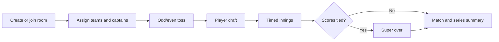

# Hand Cricket

A realtime multiplayer hand-cricket game built with React, Firebase, and a context-aware bot opponent.

The application models a complete match rather than a single number-guessing screen: players join rooms, form teams, handle the toss and draft, play timed innings, resolve ties through super overs, and review match and series results.

## Highlights

- Realtime multiplayer rooms backed by Firebase Realtime Database
- Firebase Authentication and player profiles
- Team assignment, captains, toss, player draft, and roster balancing
- Configurable overs and best-of series formats
- Hidden, locked batter and bowler moves with timed resolution
- Innings, wickets, targets, scorecards, match summaries, and man-of-the-match results
- Super-over selection and tie resolution
- Adaptive bot that combines recent move patterns with stored context data
- Responsive interface, motion effects, audio feedback, and multiple visual themes
- Extensive component, context, Firebase utility, and bot tests
- Firebase Hosting deployment workflows

## Game flow



Both player moves are stored as locked values and revealed together during a delivery. Multiplayer state is coordinated through `MultiplayerContext` and the Firebase room helpers, while solo game state and bot play are handled separately.

## Technology stack

| Area | Technology |
| --- | --- |
| UI | React 19, React Router, Tailwind CSS |
| Motion and icons | Framer Motion, Lucide React |
| Realtime and auth | Firebase Realtime Database, Firebase Authentication |
| Build | Vite 8 |
| Tests | Vitest, Testing Library, jsdom, Puppeteer |
| Deployment | Firebase Hosting, GitHub Actions |

## Project structure

```text
src/
├── ai/             adaptive bot decisions and shared pattern data
├── components/     reusable match, scorecard, timer, and profile UI
├── context/        authentication, solo game, and multiplayer state
├── hooks/          Firebase room synchronization
├── utils/          audio and Firebase transformation helpers
├── App.jsx         application screens and match orchestration
└── firebase.js     Firebase client initialization
```

## Local development

### Prerequisites

- Node.js 20+
- npm
- A Firebase project if you want to use your own database and authentication environment

### Install and run

```bash
git clone https://github.com/Sandeshkumar0/Hand_Cricket.git
cd Hand_Cricket
npm install
npm run dev
```

Vite prints the local URL, normally `http://localhost:5173`.

The repository currently initializes the deployed Firebase project in `src/firebase.js`. When creating a separate deployment, replace that public client configuration and apply the database rules from `database.rules.json` to the new Firebase project.

> Firebase web configuration identifies a Firebase project; it is not a server credential. Access control must be enforced by Authentication and Realtime Database Security Rules.

## Quality checks

```bash
npm run lint
npm test
npm run coverage
npm run build
```

The automated suite covers UI components, authentication, game reducers, multiplayer transitions, room mapping, Firebase helpers, bot memory, and bot decisions. Run the full suite after changing scoring or multiplayer state because those paths share match invariants.

## Realtime data model

Room state is stored under `rooms/{roomCode}`. Authenticated room members may read a room, while writes are constrained to the host or the authenticated player's own state by `database.rules.json`.

Important state groups include:

- room metadata and host identity
- players, teams, captains, and rosters
- toss and draft selections
- current innings, locked moves, score, wickets, and timers
- series scores, completed-match summaries, and super-over state

Bot pattern data is stored separately from live room state so decisions can combine the current match context with previously observed moves.

## Deployment

Create a production build with:

```bash
npm run build
```

Firebase Hosting configuration is included in `firebase.json`. GitHub Actions workflows support preview deployments for pull requests and a production deployment after merges, provided the repository's Firebase credentials are configured in GitHub.

## Current limitations

- Match authority is distributed across Firebase clients; a hardened competitive version should validate critical transitions on a trusted backend.
- Network reconnect and host migration behavior needs broader end-to-end testing.
- Ranking, matchmaking, moderation, and anti-abuse systems are not implemented.
- Firebase Analytics should be initialized conditionally for non-browser test environments.

## Roadmap

- Server-authoritative move validation and anti-cheat event logs
- Ranked matchmaking, seasonal leaderboards, and player statistics
- Reconnect-safe rooms and host migration
- Spectator mode and shareable match replays
- Installable PWA with offline solo play
- Browser-level multiplayer tests against Firebase Emulator Suite

## License

No license has been declared yet. Add one before accepting external contributions or reuse.
